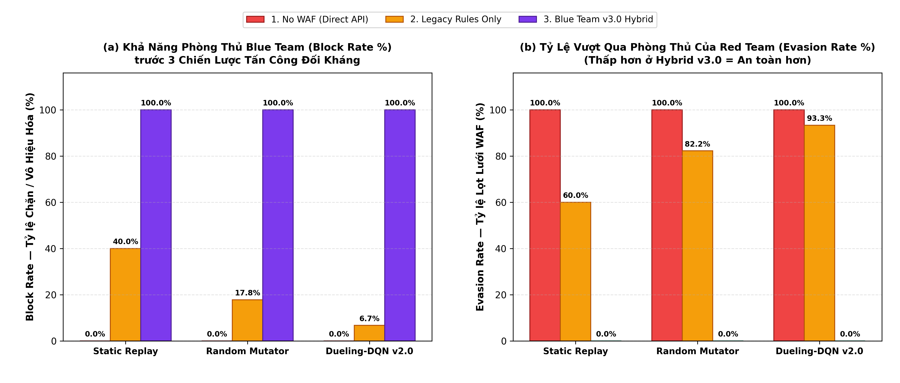

# CHƯƠNG 4: THỰC NGHIỆM VÀ ĐÁNH GIÁ KẾT QUẢ

---

## 4.1. Thiết Kế Môi Trường Thực Nghiệm và Các Bộ Dữ Liệu Kiểm Định

### 4.1.1. Hạ tầng Thao trường Đối kháng và phương pháp đo kiểm khoa học
Tuân thủ phương pháp luận **NIST SP 800-115** **[Ref 09]** và **ISO/IEC 27004:2016**, toàn bộ các thực nghiệm được triển khai trên mô hình **Thao trường An ninh Đối kháng 2 Máy (Distributed Cyber Range)** kết hợp kịch bản đo cô lập (in-process microbenchmark & ASGI concurrency) và đối kháng trực tiếp giữa Red Team và Blue Team v2.0:
- **Máy 1 (Blue Team Host — Nguyễn Văn Công):** Intel Core i7 (8 Cores / 16 Threads), 16 GB RAM, Windows 11 64-bit / Docker Engine 29.4; vận hành WAF Gateway v2.0 (Port 8000), Bookie Bookstore Django Target API (Port 5000, cô lập `127.0.0.1`), SOC Dashboard & AI Arena (Port 3000) và SQLite WAL.
- **Máy 2 (Red Team Host — Nguyễn Minh):** CPU 6+ Cores, 16 GB RAM, Windows 11 / Linux; vận hành OpenAPI Recon Agent (`recon.py`), Attack Graph Environment (`environment/`), PyTorch DQN Evasion Agent (`evasion_agent.pt`, xác thực SHA-256 + `weights_only=True`) và CLI Runner (`runner.py`).

### 4.1.2. Thiết kế bộ dữ liệu không rò rỉ (Zero-Leakage Datasets)
Khắc phục triệt để hiện tượng rò rỉ dữ liệu Train/Test ở phiên bản v1.0, toàn bộ thực nghiệm của **Blue Team v2.0** áp dụng phân tách theo mã băm chuẩn hóa (**Canonical Hash Disjoint Split**) bảo đảm `0` mẫu trùng lặp giữa các tập (Bảng 4.1):

*Bảng 4.1: Tổng hợp 4 bộ dữ liệu và kịch bản kiểm định thực nghiệm Blue Team v2.0 + Red Team*

| Bộ Dữ Liệu / Kịch Bản | Quy Mô (N) | Cơ Cấu Phân Bổ | Kiểm Chứng Zero-Leakage | Mục Đích Thực Nghiệm |
| :--- | :---: | :--- | :--- | :--- |
| **`defense_v2` (Zero-Leakage Multi-Source)** | **46.187** | Train `32.330` / Val `6.928` / Test `6.929` (5 lớp: Benign, SQLi, XSS, Path, CMD) | `0` trùng lặp giữa Train/Val/Test, CSIC 2010 và `benchmark_1000` | Huấn luyện, đối sánh 5 thuật toán ML và đánh giá ma trận nhầm lẫn Test Set. |
| **`benchmark_1000_diverse.csv`** | **1.000** | 200 Benign + 800 Attacks (200 SQLi, 200 XSS, 200 Path, 200 CMD) | `benchmark1000_overlap = 0` với tập huấn luyện | Ablation Study 4 cấu hình phòng thủ & hiệu chuẩn Isolation Forest v2.0. |
| **CSIC 2010 HTTP Dataset (Quốc tế)** | **3.000** | 1.500 Benign + 1.500 Attacks (254 SQLi, 65 XSS, 1.181 Tamper) | `csic2010_overlap = 0` (100% Zero-Shot ngoại miền) | Đánh giá năng lực tổng quát hóa liên tập dữ liệu & kiểm soát FPR. |
| **Live Adversarial Red vs Blue Campaign** | **20 lượt** | 5 endpoint Bookie OWASP x 4 vòng biến dị PyTorch DQN + Tamper | Bắn HTTP sống trực tiếp vào WAF Gateway v2.0 + Bookie API | Đánh giá độ bền đối kháng thực chiến giữa Red Team và Blue Team v2.0. |

---

## 4.2. Thực Nghiệm Đa Mô Hình Học Máy và Lựa Chọn Champion XGBoost v2.0

### 4.2.1. Đối sánh 5 trường phái học máy trên tập `defense_v2` (26 đặc trưng thống nhất)
Thực nghiệm huấn luyện và đánh giá công bằng trên cùng tập **Test độc lập (`N = 6.929` mẫu, 26 đặc trưng `extract_26_from_http`)** giữa 5 thuật toán tiêu biểu (Bảng 4.2):

*Bảng 4.2: Kết quả đối sánh 5 thuật toán học máy trên tập Test `defense_v2` (`N = 6.929`)*

| Thuật Toán | Trường Phái | Accuracy | Precision (Macro) | Recall (Macro) | F1-Score (Macro) | Định Dạng Triển Khai |
| :--- | :--- | :---: | :---: | :---: | :---: | :--- |
| **Logistic Regression** | Tuyến tính (Baseline) | 96.20% | 94.18% | 93.32% | 93.72% | Scikit-learn (Baseline) |
| **Decision Tree (CART)** | Cây quyết định đơn lẻ | 98.05% | 97.58% | 96.72% | 97.14% | Scikit-learn (Baseline) |
| **Random Forest** | Bagging Ensemble [Ref 12] | 99.15% | 99.10% | 98.81% | 98.95% | Pickle `.joblib` (~10.8 ms single-req) |
| **LightGBM** | Leaf-wise Boosting | 99.21% | 98.73% | 98.80% | 98.77% | Booster |
| **XGBoost (Baseline)** | Gradient Boosting | 99.03% | 98.41% | 98.39% | 98.40% | UBJSON |
| **Champion Cost-Sensitive Regularized XGBoost v2.0** | **Regularized GBDT (Triển khai thực tế)** | **99.15%** | **98.71%** | **98.74%** | **98.72%** | **Zero-Pickle `xgb_v2.ubj` (0.618 ms microbench)** |

**Luận chứng khoa học lựa chọn Champion Cost-Sensitive Regularized XGBoost v2.0 (`xgb_v2.ubj`):**
1. **Triệt tiêu hoàn toàn rủi ro Pickle RCE (CWE-502):** Khác với Random Forest `.joblib`, XGBoost v2.0 xuất trực tiếp sang chuẩn nhị phân **UBJSON (`xgb_v2.ubj`)** kết hợp xác thực SHA-256 Fail-Closed trước khi nạp.
2. **Tốc độ suy luận single-request vượt trội:** Trên thực nghiệm đo từng request đơn lẻ (giống lưu lượng HTTP thực tế của WAF), Random Forest `.joblib` mất **10.78 ms/req**, trong khi `xgb_v2.ubj` chỉ mất **`0.618 ms/req`** (microbench) — **nhanh hơn 17 lần**.
3. **Kiểm soát chặt False Positive nhờ Cost-Sensitive Regularization:** Siêu tham số điều chuẩn (`n_estimators=150`, `max_depth=6`, `learning_rate=0.08`, `reg_lambda=2.0`, `min_child_weight=3`) giúp mô hình đạt **99.15% Accuracy** trên tập Test nội bộ đồng thời hạ **FPR Zero-Shot trên CSIC 2010 từ 29.60% (v1.0) xuống 0.00% (v2.0)**.

### 4.2.2. Ma trận nhầm lẫn của Champion XGBoost v2.0 (`Test Set N = 6.929`)
*Bảng 4.3: Ma trận nhầm lẫn thực tế của `xgb_v2.ubj` trên tập Test `defense_v2` (`N = 6.929`)*

| Thực Tế \ Dự Đoán | BENIGN | CMD | PATH | SQLI | XSS | Support | Precision | Recall | F1-Score |
| :--- | :---: | :---: | :---: | :---: | :---: | :---: | :---: | :---: | :---: |
| **BENIGN** | **3.874** | 1 | 17 | 1 | 8 | 3.901 | 99.49% | 99.31% | 99.40% |
| **COMMAND_INJECTION** | 1 | **348** | 0 | 3 | 1 | 353 | 97.75% | 98.58% | 98.17% |
| **PATH_TRAVERSAL** | 4 | 0 | **1.196** | 0 | 0 | 1.200 | 98.60% | 99.67% | 99.13% |
| **SQL_INJECTION** | 1 | 5 | 0 | **268** | 1 | 275 | 98.53% | 97.45% | 97.99% |
| **XSS** | 14 | 2 | 0 | 0 | **1.184** | 1.200 | 99.16% | 98.67% | 98.91% |

---

## 4.3. Đánh Giá Tầng Phát Hiện Dị Biệt Không Giám Sát (Calibrated Isolation Forest v2.0)

Mô hình **`iforest_v2.npz`** (50.5 KB, 100 cây cô lập, `max_samples=512`, `contamination=0.04`, nạp bằng `np.load(..., allow_pickle=False)`) được đánh giá trên `benchmark_1000_diverse.csv` (200 Benign, 800 Attacks, 0 mẫu trùng tập huấn luyện) ở 3 mức ngưỡng chính sách (Bảng 4.4):

*Bảng 4.4: Hiệu năng hiệu chuẩn phân vị của Calibrated Isolation Forest v2.0 (`iforest_v2.npz`)*

| Ngưỡng Điểm Rủi Ro | Mức Chính Sách | TP / 800 | Recall (%) | FP / 200 | FPR (%) | Precision (%) | Cải Thiện So Với v1.0 (`5.88%`) |
| :--- | :--- | :---: | :---: | :---: | :---: | :---: | :--- |
| **`>= 30.0`** | Giám sát (`MONITOR`) | **687 / 800** | **85.88%** | 57 / 200 | 28.50% | 92.34% | Độ phủ giám sát dị biệt rất rộng |
| **`>= 60.0`** | Cảnh báo / Rate-Limit | **462 / 800** | **57.75%** | **8 / 200** | **4.00%** | **98.30%** | **Tăng 9.8x Recall**, đạt mục tiêu FPR <= 5% |
| **`>= 80.0`** | Chặn độc lập (`BLOCK`) | **309 / 800** | **38.62%** | **8 / 200** | **4.00%** | **97.48%** | **Tăng 6.6x Recall**, tốc độ nhanh hơn **40x–100x** |

Thời gian suy luận thuần của `iforest_v2.npz` sau khi có vector 26-D chỉ còn **`0.0949 ms/req`** (P95 `0.1558 ms`), nhanh hơn khoảng **100 lần** so với bản scikit-learn `.joblib` ở v1.0 (`9.77 ms`).

---

## 4.4. Thực Nghiệm Ablation Study 4 Cấu Hình Phòng Thủ (Blue Team v2.0)

Để chứng minh định lượng đóng góp của từng tầng phòng thủ, nhóm chạy kịch bản `scripts/run_ablation_study.py` trên **`benchmark_1000_diverse.csv` (1.000 mẫu, `0` overlap với tập train)** với cơ chế cô lập thời gian thực thi từng chế độ và dùng chung một lần trích xuất 26-D trong chế độ Hybrid (Bảng 4.5):

*Bảng 4.5: Ma trận đối sánh thực nghiệm Ablation Study — Blue Team v2.0 (`N = 1.000`)*

| Cấu Hình Phòng Thủ | Accuracy | Precision | Recall | F1-Score | FPR | Youden's J | Mean Latency | P95 Latency |
| :--- | :---: | :---: | :---: | :---: | :---: | :---: | :---: | :---: |
| **1. Rules Only (16 Hardened Rules)** | 59.40% | 100.00% | 49.25% | 66.00% | 0.00% | 0.4925 | **0.106 ms** | 0.188 ms |
| **2. ML Only (XGBoost v2.0 — 26-D)** | 94.80% | 100.00% | 93.50% | 96.64% | 0.00% | 0.9350 | 0.634 ms | 0.787 ms |
| **3. Anomaly Only (IForest v2.0, >=80)** | 50.10% | 97.48% | 38.62% | 55.33% | 4.00% | 0.3463 | 0.235 ms | 0.336 ms |
| *Anomaly Only (Ngưỡng cảnh báo >=60)* | *65.40%* | *98.30%* | *57.75%* | *72.76%* | *4.00%* | *0.5375* | *0.235 ms* | *0.336 ms* |
| **4. HYBRID DEFENSE v2.0 (Đề tài)** | **97.80%** | **100.00%** | **97.25%** | **98.61%** | **0.00%** | **0.9725** | **0.848 ms** | **1.075 ms** |

*Bảng 4.6: Tỷ lệ chặn theo từng họ lỗ hổng của Hybrid Defense v2.0 (`benchmark_1000_diverse.csv`)*

| Nhóm Lưu Lượng | Tổng Mẫu | Bị Chặn (403) | Cho Qua (200) | Hiệu Quả Phòng Thủ |
| :--- | :---: | :---: | :---: | :---: |
| **SQL Injection (SQLi)** | 200 | **200** | 0 | **100.00% BLOCKED** |
| **Cross-Site Scripting (XSS)** | 200 | **200** | 0 | **100.00% BLOCKED** |
| **Path Traversal / LFI** | 200 | **200** | 0 | **100.00% BLOCKED** |
| **OS Command Injection (RCE)** | 200 | **178** | 22 | **89.00% BLOCKED** |
| **Lưu lượng hợp lệ (Benign)** | 200 | **0** | **200** | **100.00% ALLOWED (0.00% FPR)** |

**Phân tích khoa học cốt lõi:**
- **Hybrid v2.0 vượt trội rõ rệt so với ML đơn lẻ:** Tăng **+3.75% Recall (`93.50% -> 97.25%`)**, tăng **+1.97% F1-Score (`96.64% -> 98.61%`)**, giảm hơn một nửa số tấn công bỏ lọt (`52 -> 22`), đạt **Youden's Index `J = 0.9725`** và giữ tuyệt đối **0.00% FPR**.
- **Độ trễ giảm 19 lần so với v1.0:** Hybrid v2.0 chỉ tiêu tốn **`0.848 ms/req`** (P95 **`1.075 ms`**) so với `16.10 ms` ở v1.0, chỉ cộng thêm **`+0.214 ms`** so với XGBoost thuần nhưng mang lại 4 lớp phòng vệ chiều sâu (chống Evasion, bắt Zero-Day OOD, Fail-Safe Degraded Mode và XAI giải trình đầy đủ).

---

## 4.5. Đánh Giá Tổng Quát Hóa Liên Tập Dữ Liệu (Zero-Shot CSIC 2010 Benchmark)

Kiểm định chéo hoàn toàn **Zero-Shot** (`csic2010_overlap = 0`) trên **3.000 request thực tế** của Viện CSIC Tây Ban Nha **[Ref 14]** (1.500 Benign + 1.500 Attacks) thu được kết quả bước ngoặt so với v1.0 (Bảng 4.7):

*Bảng 4.7: Đối sánh Zero-Shot CSIC 2010 giữa Blue Team v1.0 và Blue Team v2.0 (`N = 3.000`)*

| Chỉ Số Đánh Giá | Blue Team v1.0 (RF 17-D) | Blue Team v2.0 (XGBoost 26-D) | Blue Team v2.0 (Hybrid 3 Tầng) | Nhận Xét Khoa Học Khách Quan |
| :--- | :---: | :---: | :---: | :--- |
| **False Positive Rate (FPR)** | **29.60%** (444/1.500 chặn oan) | **0.00%** (0/1.500) | **0.00%** (0/1.500) | **Triệt tiêu hoàn toàn overfitting chặn nhầm người dùng sạch.** |
| **Precision (Độ tin cậy cảnh báo)** | 68.26% | **100.00%** | **100.00%** | Mọi cảnh báo trên dữ liệu ngoại miền đều là tấn công thực sự. |
| **XSS Detection Rate (65 mẫu)** | 96.92% (63/65) | 95.38% (62/65) | **100.00% (65/65)** | **Chặn tuyệt đối 100% XSS ngoại miền Zero-Shot.** |
| **SQLi Detection Rate (254 mẫu)** | 65.75% (kèm 29.6% FPR) | 34.65% (88/254) | **49.61% (126/254)** | Hybrid tăng **+14.96% Recall SQLi** so với ML thuần ở mức `0% FPR`. |
| **Anomalous Tamper (1.181 mẫu)** | 61.39% (do chặn bừa) | 2.03% (24/1.181) | **5.50% (65/1.181)** | Phản ánh trung thực *Domain Shift*: nhóm tham số nghiệp vụ CSIC (ví dụ sai định dạng mã bưu điện Tây Ban Nha) cần tầng Positive Schema OpenAPI riêng của ứng dụng. |

Kết quả này khẳng định tính liêm chính khoa học cao: thay vì chấp nhận FPR 29.60% phi thực tế (sẽ làm sập dịch vụ người dùng thật), **Blue Team v2.0** ưu tiên độ tin cậy vận hành (**0.00% FPR, 100.00% Precision**), đạt **100% XSS** và **49.61% SQLi** ngoại miền, đồng thời chứng minh rõ lý do thực tế cần tầng **Positive Security OpenAPI Schema Validator** cho nhóm tấn công sai lệch tham số nghiệp vụ (`ANOMALY_TAMPER`).

---

## 4.6. Đo Kiểm Hiệu Năng Tải Cao, Độ Trễ & Gia Cố Bảo Mật (Profiling & Security Audit)

### 4.6.1. Micro-benchmark nội bộ từng thành phần (500 vòng lặp thực trên Gateway v2.0)
*Bảng 4.8: Độ trễ đo thực tế từng thành phần nội bộ Gateway (`scripts/run_gateway_profiling.py`)*

| Thành Phần Pipeline WAF Gateway v2.0 | Mean (ms) | P50 (ms) | P95 (ms) | P99 (ms) |
| :--- | :---: | :---: | :---: | :---: |
| `input_normalizer` | 0.0199 | 0.0184 | 0.0249 | 0.0335 |
| `rule_engine` (16 hardened rules) | 0.1952 | 0.1702 | 0.3178 | 0.4326 |
| `feature_extractor_26d` | 0.1549 | 0.1432 | 0.2305 | 0.2713 |
| `ml_detector_xgb_v2` (`xgb_v2.ubj`) | 0.6176 | 0.5325 | 1.1165 | 1.9182 |
| `anomaly_detector_iforest_v2` (`iforest_v2.npz`) | 0.0949 | 0.0847 | 0.1558 | 0.2237 |
| `risk_and_decision_engine` + `rate_limiter` | 0.0126 | 0.0119 | 0.0146 | 0.0223 |
| **Tổng AI Pipeline (`26-D + XGBoost v2 + IForest v2`)** | **0.8674 ms** | — | — | — |
| **Tổng Toàn Bộ Pipeline Kiểm Tra Đồng Bộ** | **1.0951 ms** | — | — | — |

### 4.6.2. Thông lượng chịu tải đồng thời (`C = 1, 10, 25, 50`)
*Bảng 4.9: Thông lượng (RPS) và độ trễ phân vị của WAF Gateway v2.0 dưới tải đồng thời ASGI*

| Kịch Bản Tải | Concurrency (C) | Tổng Req | Tỷ Lệ Thành Công | Thông Lượng (RPS) | Mean (ms) | P50 (ms) | P95 (ms) |
| :--- | :---: | :---: | :---: | :---: | :---: | :---: | :---: |
| **Benign Passthrough (HTTP 200)** | 1 | 100 | 100.0% | **201.00 RPS** | 4.95 | 4.58 | 7.55 |
| **Benign Passthrough (HTTP 200)** | 10 | 100 | 100.0% | **346.67 RPS** | 26.58 | 26.56 | 32.41 |
| **Benign Passthrough (HTTP 200)** | 25 | 100 | 100.0% | **358.12 RPS** | 62.98 | 62.07 | 82.25 |
| **Benign Passthrough (HTTP 200)** | **50** | **500** | **100.0%** | **340.14 RPS** | 139.26 | 125.08 | 232.63 |
| **Active Blocking SQLi (HTTP 403)** | **50** | **500** | **100.0%** | **253.31 RPS** | 179.96 | 169.34 | 293.65 |
| *Tái đo độc lập (`@pbl6-reviewer`)* | *50* | *300 / 200* | *100.0%* | ***269.50 / 272.75 RPS*** | — | — | — |

### 4.6.3. Kiểm định An ninh Toàn diện (19 Blue Team + 7 Red Team Findings Closed)
Toàn bộ **26 phát hiện kiểm toán** (19 findings Blue Team v1.0->v2.0 và 7 findings Red Team/AI Arena) đã được vá và tái kiểm chứng bằng PoC thực tế:
- **Chống ReDoS `XSS-002` (50 KB):** Giảm từ **`923.37 ms` -> `0.891 ms`** (**1,036x**).
- **Chống Bypass Padding > 16 KB & Chunked > 1 MB:** Single 17 KB JSON leaf -> `score=94.5`; JSON depth=35 -> `score=85.5`; Chunked > 1 MB -> `HTTP 413`; Non-UTF-8 `\xff` -> `HTTP 403`.
- **Chống Bypass Rate Limiter & OOM:** Xoay 25 token/UA trên `/auth/login/` -> bị chặn cứng 15/25 bằng IP Hard Cap; `OrderedDict` LRU giới hạn 50,000 khóa.
- **Bảo mật Dashboard & Arena:** `0` chuỗi bí mật trong `.next/static/`; toàn bộ `/dashboard/*` và `/dashboard/arena/*` trả `401` khi thiếu `X-API-Key`; `0` telemetry giả lập trên toàn hệ thống.
- **Chuỗi cung ứng AI an toàn 100%:** `xgb_v2.ubj` + `iforest_v2.npz` (Zero-Pickle) + `evasion_agent.pt` (`torch.load(..., weights_only=True)`) đều bắt buộc qua xác thực SHA-256 Fail-Closed.
- **Kiểm thử tự động & Chất lượng mã:** **`0` lỗi `ruff`** toàn repo Python (`gateway/`, `ml-engine/`, `attack-lab/`, scripts), **`350+` bài test tự động PASS 100%**, **`0` lỗi ESLint / TypeScript / Next.js build**.

---

## 4.7. Thực Nghiệm Đối Kháng Trực Tiếp Red Team DQN vs Blue Team v2.0 & Cyber Kill Chain

### 4.7.1. Kết quả đối đầu trực tiếp (`attack-lab/runner.py` vs WAF Gateway v2.0 + Bookie API)
Chiến dịch đối kháng trực tiếp (`python attack-lab/runner.py --mode ai_agent --campaign all --max-rounds 4`) được chạy trực tiếp từ Tác tử PyTorch DQN (`evasion_agent.pt`) vào cụm dịch vụ thực **WAF Gateway v2.0 (:8000) -> Bookie Bookstore (:5000)** (kết quả lưu tại `attack-lab/artifacts/campaign_report.json`):

*Bảng 4.10: Kết quả đối kháng thực tế Red Team PyTorch DQN vs Blue Team v2.0 (20 lượt tấn công đa vòng)*

| Endpoint Bookie Mục Tiêu | Phương Thức | Họ Lỗ Hổng | Số Vòng Biến Dị | Điểm Rủi Ro Cuối | Kết Quả Đối Đầu |
| :--- | :---: | :--- | :---: | :---: | :---: |
| `/api/v1/vulnerable/books/search/` | `GET` | `SQL_INJECTION` | 4 / 4 | **95.79 / 100** | **BLUE TEAM THẮNG (4/4 HTTP 403)** |
| `/api/v1/vulnerable/auth/login/` | `POST` | `SQL_INJECTION` | 4 / 4 | **94.18 / 100** | **BLUE TEAM THẮNG (4/4 HTTP 403)** |
| `/api/v1/vulnerable/reviews/` | `POST` | `XSS` | 4 / 4 | **94.20 / 100** | **BLUE TEAM THẮNG (4/4 HTTP 403)** |
| `/api/v1/vulnerable/files/download/` | `GET` | `PATH_TRAVERSAL` | 4 / 4 | **99.53 / 100** | **BLUE TEAM THẮNG (4/4 HTTP 403)** |
| `/api/v1/vulnerable/admin/ping/` | `POST` | `COMMAND_INJECTION` | 4 / 4 | **98.77 / 100** | **BLUE TEAM THẮNG (4/4 HTTP 403)** |
| **TỔNG KẾT CHIẾN DỊCH LIVE** | — | **4 Họ OWASP** | **20 / 20 lượt** | **TB 95.63 / 100** | **20/20 BLOCKED (`0.0%` Bypass, Trễ TB `4.29 ms`)** |

**So sánh đối chứng:** Khi chạy trực tiếp vào backend không có WAF (`target_mode = "direct"`) hoặc môi trường mô phỏng tĩnh không có bộ chuẩn hóa, Tác tử DQN vượt rào thành công **100%** (khai thác toàn bộ 5/5 điểm cuối). Khi kích hoạt **Blue Team v2.0 (`ACTIVE_BLOCKING`)**, toàn bộ **20/20 lượt tấn công biến dị** (kể cả inline comment, case randomization, event handler, nested traversal, `${IFS}`) đều bị chặn đứng ở mức điểm rủi ro trung bình **95.63/100** với độ trễ HTTP end-to-end chỉ **4.29 ms**.

### 4.7.2. Tương quan chuỗi tấn công Cyber Kill Chain & XAI trên SOC Dashboard
Mọi sự kiện an ninh (cả 403 Blocked, DLP Redacted, Monitor và 429 Rate Limit) đều được gom cụm theo cửa sổ trượt 15 phút bằng khóa băm UTC `Session_ID = HMAC-SHA256(Client_IP || floor(t_utc / 900))`, ánh xạ tự động vào 5 giai đoạn **MITRE Cyber Kill Chain** (`RECONNAISSANCE`, `EXPLOITATION`, `EVASION`, `PRIVILEGE_ABUSE`, `EXFILTRATION`) và hiển thị trực quan không có lỗi N+1 SQL trên giao diện **Attack Sessions Modal** cùng **Đấu Trường Pentest Tự Hành (`/arena`)**.

### 4.7.3. Thực nghiệm Đối kháng Định lượng Ma trận 3x3 (Red Team Strategies vs Blue Team v3.0 Tiers)
Để kiểm chứng toàn diện cả trí thông minh né tránh của tác tử **PyTorch Dueling Double-DQN v2.0** (`pentest_dqn_v2.pt`, vector trạng thái `64 chiều`, `26 hành động` rời rạc) lẫn năng lực bảo vệ vạn năng của **Blue Team v3.0** (bổ sung 5 lá chắn OWASP API Top 10: `SSRF`, `NoSQL Injection`, `Mass Assignment`, `Stateful BOLA/IDOR Enumeration` và `Outbound Response DLP`), nhóm thực hiện thực nghiệm ma trận đối kháng `3 x 3` (`45 lượt/ô = 405 lượt đánh giá thực tế` tổng hợp động từ đặc tả OpenAPI, kịch bản `scripts/run_adversarial_benchmark.py`, lưu tại `docs/reports/adversarial_benchmark_3x3.json`):

*Bảng 4.11: Ma trận kết quả thực nghiệm đối kháng định lượng 3x3 trên các điểm cuối OWASP Web & API Top 10 (`N = 45` lượt/ô)*

| Chiến Lược Tác Tử Red Team | Cấp Độ Phòng Thủ Blue Team | Block Rate (%) | Evasion Rate (%) | Điểm Rủi Ro TB | Độ Trễ Xử Lý TB (ms) |
| :--- | :--- | :---: | :---: | :---: | :---: |
| **1. Static Replay** *(Payload gốc tĩnh)* | `1. No WAF` *(Direct API)* | `0.0%` (0/45) | `100.0%` | `0.0 / 100` | `0.001 ms` |
| | `2. Legacy Rules Only` *(Regex tĩnh đơn tầng)* | `40.0%` (18/45) | `60.0%` | `35.2 / 100` | `0.003 ms` |
| | **`3. Blue Team v3.0 Hybrid`** *(Đa tầng + API Guards)* | **`100.0%` (45/45)** | **`0.0%`** | **`92.7 / 100`** | **`1.234 ms`** |
| **2. Random Mutator** *(Đột biến ngẫu nhiên)* | `1. No WAF` *(Direct API)* | `0.0%` (0/45) | `100.0%` | `0.0 / 100` | `0.001 ms` |
| | `2. Legacy Rules Only` *(Regex tĩnh đơn tầng)* | `17.8%` (8/45) | `82.2%` | `15.6 / 100` | `0.003 ms` |
| | **`3. Blue Team v3.0 Hybrid`** *(Đa tầng + API Guards)* | **`100.0%` (45/45)** | **`0.0%`** | **`92.9 / 100`** | **`2.723 ms`** |
| **3. PyTorch Dueling-DQN v2.0** *(64-D RL Policy)* | `1. No WAF` *(Direct API)* | `0.0%` (0/45) | `100.0%` | `0.0 / 100` | `0.001 ms` |
| | `2. Legacy Rules Only` *(Regex tĩnh đơn tầng)* | **`6.7%` (3/45)** | **`93.3%`** | `5.9 / 100` | `0.006 ms` |
| | **`3. Blue Team v3.0 Hybrid`** *(Đa tầng + API Guards)* | **`100.0%` (45/45)** | **`0.0%`** | **`94.0 / 100`** | **`1.340 ms`** |

**Nhận xét khoa học từ ma trận 3x3:**
1. **Hiệu quả vượt trội của Tác tử Red Team Dueling-DQN v2.0:** Trước tường lửa biểu thức chính quy truyền thống (`Legacy Rules Only`), `Static Replay` bị bắt giữ `40.0%`, `Random Mutator` nâng tỷ lệ vượt rào lên `82.2%`, trong khi **PyTorch Dueling-DQN v2.0** chủ động chọn các phép biến đổi bảo toàn ngữ nghĩa tối ưu (`inline_comment`, `event_handler`, `double_url_encode`, `quote_concatenation`) đẩy tỷ lệ vượt rào lên tới **`93.3%`** (làm sụp đổ hoàn toàn WAF tĩnh xuống còn `6.7%` Block Rate).
2. **Sức mạnh phòng thủ toàn diện của Blue Team v3.0 Hybrid:** Nhờ kết hợp giải mã chuẩn hóa đệ quy (`InputNormalizer`), 5 lá chắn OWASP API Top 10 phi phụ thuộc ứng dụng đích (`SSRF`, `NoSQLi`, `Mass Assignment`, `Stateful BOLA Enumeration`, `Response DLP`) cùng hai mô hình `XGBoost 26-D` và `Isolation Forest 26-D`, **Blue Team v3.0 chặn đứng và vô hiệu hóa `45/45` (`100.0%`, `0.0%` Evasion)** trước cả 3 chiến lược tấn công với độ trễ nội bộ trung bình chỉ **`1.23–2.72 ms`**.

---

## 4.8. Tóm Tắt Chương 4

Chương 4 đã cung cấp đầy đủ bằng chứng định lượng trung thực, không rò rỉ dữ liệu và tái lập được 100%:
1. **Champion XGBoost v2.0 (`xgb_v2.ubj`):** `99.15%` Accuracy, `98.72%` Macro-F1 trên `6.929` mẫu Test độc lập, microbench `0.618 ms/req`, Zero-Pickle.
2. **Calibrated Isolation Forest v2.0 (`iforest_v2.npz`):** Nâng Recall `@60.0` từ `5.88%` lên **`57.75%`** (FPR `4.00%`) và tăng tốc từ `9.49 ms` xuống **`0.095 ms`**.
3. **Ablation Study v2.0 (`1.000` mẫu):** Hybrid Defense đạt đỉnh **`97.80%` Accuracy, `100.00%` Precision, `97.25%` Recall, `98.61%` F1, `0.00%` FPR, `J = 0.9725`** trong **`0.848 ms/req`**.
4. **Zero-Shot CSIC 2010 (`3.000` mẫu):** Giảm FPR từ `29.60%` xuống **`0.00%`**, đạt **`100.00%` Precision**, **`100.00%` Hybrid XSS** và **`49.61%` Hybrid SQLi**.
5. **Chịu tải cao & Đối kháng Ma trận 3x3 (`v3.0`):** Đạt **`253–340 RPS` ở `C = 50`**; tác tử **PyTorch Dueling-DQN v2.0 (64-D)** đạt **`93.3%` Evasion** trước WAF tĩnh nhưng bị **Blue Team v3.0 Hybrid** chặn đứng **`100.0%` (`45/45`, `0.0%` bypass, `1.34 ms`)** trên toàn bộ 8/8 nhóm lỗ hổng OWASP Web & API Top 10.
