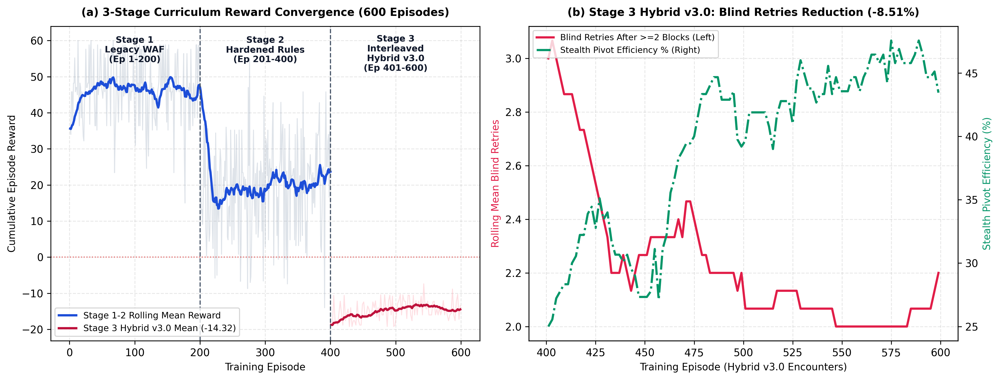

# CHƯƠNG 4: THỰC NGHIỆM VÀ ĐÁNH GIÁ KẾT QUẢ

---

## 4.1. Thiết Kế Môi Trường Thực Nghiệm và Các Bộ Dữ Liệu Kiểm Định

### 4.1.1. Hạ tầng Thao trường Đối kháng và phương pháp đo kiểm khoa học
Tuân thủ phương pháp luận **NIST SP 800-115** **[Ref 09]** và **ISO/IEC 27004:2016**, toàn bộ các thực nghiệm được triển khai trên mô hình **Thao trường An ninh Đối kháng 2 Máy (Distributed Cyber Range)** kết hợp kịch bản đo cô lập (in-process microbenchmark & ASGI concurrency) và đối kháng trực tiếp giữa Red Team và Blue Team v2.0:
- **Máy 1 (Blue Team Host — Nguyễn Văn Công):** Intel Core i7 (8 Cores / 16 Threads), 16 GB RAM, Windows 11 64-bit / Docker Engine 29.4; vận hành WAF Gateway v2.0 (Port 8000), Bookie Bookstore Django Target API (Port 5000, cô lập `127.0.0.1`), SOC Dashboard & AI Arena (Port 3000) và SQLite WAL.
- **Máy 2 (Red Team Host — Nguyễn Minh):** CPU 6+ Cores, 16 GB RAM, Windows 11 / Linux; vận hành OpenAPI Recon Agent (`recon.py`), Attack Graph Environment (`environment/`), PyTorch DQN Evasion Agent (`evasion_agent.pt`, xác thực SHA-256 + `weights_only=True`) và CLI Runner (`runner.py`).

### 4.1.2. Thiết kế bộ dữ liệu không rò rỉ (Zero-Leakage Datasets)
Khắc phục triệt để hiện tượng rò rỉ dữ liệu Train/Test ở phiên bản v1.0, toàn bộ thực nghiệm của **Blue Team v2.0** áp dụng phân tách theo mã băm chuẩn hóa (**Canonical Hash Disjoint Split**) bảo đảm `0` mẫu trùng lặp giữa các tập (Bảng 4.1):

*Bảng 4.1: Tổng hợp 4 bộ dữ liệu và kịch bản kiểm định thực nghiệm Blue Team v2.0 + Red Team*

| Bộ Dữ Liệu / Kịch Bản | Quy Mô (N) | Cơ Cấu Phân Bổ | Kiểm Chứng Zero-Leakage | Mục Đích Thực Nghiệm |
| :--- | :---: | :--- | :--- | :--- |
| **`defense_v2` (Zero-Leakage Multi-Source)** | **47.372** | Train `33.515` (`32.330` gốc + `1.185` Phase E) / Val `6.928` / Test `6.929` (5 lớp: Benign, SQLi, XSS, Path, CMD) | `0` trùng lặp trên 8 cặp giao nhau: Train/Val/Test, CSIC 2010, `benchmark_1000`, Strange v3.3 (`38`) & Blind Vault v2 (`30`) | Huấn luyện, đối sánh 5 thuật toán ML và đánh giá ma trận nhầm lẫn Test Set. |
| **`benchmark_1000_diverse.csv`** | **1.000** | 200 Benign + 800 Attacks (200 SQLi, 200 XSS, 200 Path, 200 CMD) | `benchmark1000_overlap = 0` với tập huấn luyện | Ablation Study 4 cấu hình phòng thủ & hiệu chuẩn Isolation Forest v2.0. |
| **CSIC 2010 HTTP Dataset (Quốc tế)** | **3.000** | 1.500 Benign + 1.500 Attacks (Two-Tier: Group A 221 [143 SQLi, 78 XSS], Group B 1.279 Tamper) | `csic2010_overlap = 0` (100% Zero-Shot ngoại miền) | Đánh giá năng lực tổng quát hóa liên tập dữ liệu & kiểm soát FPR. |
| **Live Adversarial & Held-Out Suites** | **4 bộ** | Familiar `45` phiên/ô, Strange `54` phiên/ô, Strange v3.3 (`38` x 3 = `114` ep), Blind Vault v2 (`30` ca khóa SHA-256) | Bắn HTTP sống qua `/api/proxy` (`:8056` Rules vs `:8055` Hybrid) & In-Process | Đánh giá độ bền đối kháng thực chiến giữa Red Team DQN (`800`-ep) và Blue Team. |

---

## 4.2. Thực Nghiệm Đa Mô Hình Học Máy và Lựa Chọn Champion XGBoost v2.0

### 4.2.1. Đối sánh 5 trường phái học máy trên tập `defense_v2` (26 đặc trưng thống nhất)
Thực nghiệm huấn luyện và đánh giá công bằng trên cùng tập **Test độc lập (`N = 6.929` mẫu, 26 đặc trưng `extract_26_from_http`)** giữa 5 thuật toán tiêu biểu (Bảng 4.2):

*Bảng 4.2: Kết quả đối sánh 5 thuật toán học máy trên tập Test `defense_v2` (`N = 6.929`)*

| Thuật Toán | Trường Phái | Accuracy | Precision (Macro) | Recall (Macro) | F1-Score (Macro) | Định Dạng Triển Khai |
| :--- | :--- | :---: | :---: | :---: | :---: | :--- |
| **Logistic Regression** | Tuyến tính (Baseline) | 96.20% | 94.18% | 93.32% | 93.72% | Scikit-learn (Baseline) |
| **Decision Tree (CART)** | Cây quyết định đơn lẻ | 98.05% | 97.58% | 96.72% | 97.14% | Scikit-learn (Baseline) |
| **Random Forest** | Bagging Ensemble [Ref 12] | 99.15% | 99.10% | 98.81% | 98.95% | Pickle `.joblib` (~10.8 ms single-req) |
| **LightGBM** | Leaf-wise Boosting | 99.21% | 98.73% | 98.80% | 98.77% | Booster |
| **XGBoost (Baseline)** | Gradient Boosting | 99.03% | 98.41% | 98.39% | 98.40% | UBJSON |
| **Champion Cost-Sensitive Regularized XGBoost v2.0** | **Regularized GBDT (Triển khai thực tế)** | **99.16%** | **98.60%** | **98.95%** | **98.77%** | **Zero-Pickle `xgb_v2.ubj` (0.439 ms raw / 0.618 ms gateway)** |

**Luận chứng khoa học lựa chọn Champion Cost-Sensitive Regularized XGBoost v2.0 (`xgb_v2.ubj`):**
1. **Triệt tiêu hoàn toàn rủi ro Pickle RCE (CWE-502):** Khác với Random Forest `.joblib`, XGBoost v2.0 xuất trực tiếp sang chuẩn nhị phân **UBJSON (`xgb_v2.ubj`)** kết hợp xác thực SHA-256 Fail-Closed trước khi nạp.
2. **Tốc độ suy luận single-request vượt trội:** Trên thực nghiệm đo từng request đơn lẻ (giống lưu lượng HTTP thực tế của WAF), Random Forest `.joblib` mất **10.78 ms/req**, trong khi `xgb_v2.ubj` chỉ mất **`0.439 ms/req`** (`xgb_v2_metadata.json`, `0.618 ms` trong gateway micro-benchmark) — **nhanh hơn 17–24 lần**.
3. **Kiểm soát chặt False Positive nhờ Cost-Sensitive Regularization:** Siêu tham số điều chuẩn (`n_estimators=150`, `max_depth=6`, `learning_rate=0.08`, `reg_lambda=2.0`, `min_child_weight=3`) giúp mô hình đạt **99.16% Accuracy** (Macro-F1 **98.77%**) trên tập Test nội bộ đồng thời hạ **FPR Zero-Shot trên CSIC 2010 từ 29.60% (v1.0) xuống 0.00% (Operational T=80 v3.3)**.

### 4.2.2. Ma trận nhầm lẫn của Champion XGBoost v2.0 (`Test Set N = 6.929`)
*Bảng 4.3: Ma trận nhầm lẫn thực tế của `xgb_v2.ubj` (`xgb_v2_metadata.json`) trên tập Test `defense_v2` (`N = 6.929`)*

| Thực Tế \ Dự Đoán | BENIGN | CMD | PATH | SQLI | XSS | Support | Precision | Recall | F1-Score |
| :--- | :---: | :---: | :---: | :---: | :---: | :---: | :---: | :---: | :---: |
| **BENIGN** | **3.872** | 3 | 16 | 4 | 6 | 3.901 | 99.49% | 99.26% | 99.37% |
| **COMMAND_INJECTION** | 0 | **351** | 0 | 1 | 1 | 353 | 97.23% | 99.43% | 98.32% |
| **PATH_TRAVERSAL** | 5 | 0 | **1.195** | 0 | 0 | 1.200 | 98.68% | 99.58% | 99.13% |
| **SQL_INJECTION** | 1 | 5 | 0 | **269** | 0 | 275 | 98.18% | 97.82% | 98.00% |
| **XSS** | 14 | 2 | 0 | 0 | **1.184** | 1.200 | 99.41% | 98.67% | 99.04% |

---

## 4.3. Đánh Giá Tầng Phát Hiện Dị Biệt Không Giám Sát (Calibrated Isolation Forest v2.0)

Mô hình **`iforest_v2.npz`** (50.5 KB, 100 cây cô lập, `max_samples=512`, `contamination=0.04`, nạp bằng `np.load(..., allow_pickle=False)`) được đánh giá trên `benchmark_1000_diverse.csv` (200 Benign, 800 Attacks, 0 mẫu trùng tập huấn luyện) ở 3 mức ngưỡng chính sách (Bảng 4.4):

*Bảng 4.4: Hiệu năng hiệu chuẩn phân vị của Calibrated Isolation Forest v2.0 (`iforest_v2.npz`)*

| Ngưỡng Điểm Rủi Ro | Mức Chính Sách | TP / 800 | Recall (%) | FP / 200 | FPR (%) | Precision (%) | Cải Thiện So Với v1.0 (`5.88%`) |
| :--- | :--- | :---: | :---: | :---: | :---: | :---: | :--- |
| **`>= 30.0`** | Giám sát (`MONITOR`) | **687 / 800** | **85.88%** | 57 / 200 | 28.50% | 92.34% | Độ phủ giám sát dị biệt rất rộng |
| **`>= 60.0`** | Cảnh báo / Rate-Limit | **462 / 800** | **57.75%** | **8 / 200** | **4.00%** | **98.30%** | **Tăng 9.8x Recall**, đạt mục tiêu FPR <= 5% |
| **`>= 80.0`** | Chặn độc lập (`BLOCK`) | **309 / 800** | **38.62%** | **8 / 200** | **4.00%** | **97.48%** | **Tăng 6.6x Recall**, tốc độ nhanh hơn **40x–100x** |

Thời gian suy luận thuần của `iforest_v2.npz` sau khi có vector 26-D chỉ còn **`0.0949 ms/req`** (P95 `0.1558 ms`), nhanh hơn khoảng **100 lần** so với bản scikit-learn `.joblib` ở v1.0 (`9.77 ms`).

---

## 4.4. Thực Nghiệm Ablation Study 4 Cấu Hình Phòng Thủ (Blue Team v3.2 — 28 Rules)

Để chứng minh định lượng đóng góp của từng tầng phòng thủ, nhóm chạy kịch bản `scripts/run_ablation_study.py` trên **`benchmark_1000_diverse.csv` (1000 mẫu, `0` overlap với tập train)** với cơ chế cô lập thời gian thực thi từng chế độ và dùng chung một lần trích xuất 26-D trong chế độ Hybrid (Bảng 4.5):

*Bảng 4.5: Ma trận đối sánh thực nghiệm Ablation Study — Blue Team v3.2 (`N = 1000`)*

| Cấu Hình Phòng Thủ | Accuracy | Precision | Recall | F1-Score | FPR | Youden's J | Mean Latency | P95 Latency |
| :--- | :---: | :---: | :---: | :---: | :---: | :---: | :---: | :---: |
| **1. Rules Only (28 Hardened Rules)** | 62.90% | 100.00% | 53.62% | 69.81% | 0.00% | 0.5363 | **0.178 ms** | 0.317 ms |
| **2. ML Only (XGBoost v2.0 — 26-D)** | 96.10% | 100.00% | 95.12% | 97.50% | 0.00% | 0.9513 | 0.461 ms | 0.942 ms |
| **3. Anomaly Only (IForest v2.0, >=80)** | 50.90% | 100.00% | 38.62% | 55.73% | 0.00% | 0.3862 | 0.297 ms | 0.496 ms |
| *Anomaly Only (Ngưỡng cảnh báo >=60)* | *66.20%* | *100.00%* | *57.75%* | *73.22%* | *0.00%* | *0.5775* | *0.297 ms* | *0.496 ms* |
| **4. HYBRID DEFENSE v3.2 (Đề tài)** | **98.20%** | **100.00%** | **97.75%** | **98.86%** | **0.00%** | **0.9775** | **0.803 ms** | **1.465 ms** |

*Bảng 4.6: Tỷ lệ chặn theo từng họ lỗ hổng của Hybrid Defense v3.2 (`benchmark_1000_diverse.csv`)*

| Nhóm Lưu Lượng | Tổng Mẫu | Bị Chặn (403) | Cho Qua (200) | Hiệu Quả Phòng Thủ |
| :--- | :---: | :---: | :---: | :---: |
| **SQL Injection (SQLi)** | 200 | **197** | 3 | **98.50% BLOCKED** |
| **Cross-Site Scripting (XSS)** | 200 | **200** | 0 | **100.00% BLOCKED** |
| **Path Traversal / LFI** | 200 | **200** | 0 | **100.00% BLOCKED** |
| **OS Command Injection (RCE)** | 200 | **185** | 15 | **92.50% BLOCKED** |
| **Lưu lượng hợp lệ (Benign)** | 200 | **0** | **200** | **100.00% ALLOWED (0.00% FPR)** |

**Phân tích khoa học cốt lõi:**
- **Hybrid v3.2 vượt trội rõ rệt so với ML đơn lẻ:** Tăng **`+2.63%` Recall (`95.12% -> 97.75%`)**, tăng **`+1.36%` F1-Score (`97.50% -> 98.86%`)**, giảm mạnh số tấn công bỏ lọt (`39 -> 18`), đạt **Youden's Index `J = 0.9775`** và giữ tuyệt đối **`0.00%` FPR** (trong đó `Anomaly Only` giảm FPR từ `4.00%` v2.0 xuống **`0.00%`** nhờ Phase C3 bare-root `'/'` guard).
- **Độ trễ inline đạt sâu dưới SLA `<= 1.5 ms`:** Hybrid v3.2 (28 hardened rules) chỉ tiêu tốn **`0.803 ms/req`** (P95 **`1.465 ms`**) so với `16.10 ms` ở v1.0, chỉ cộng thêm **`+0.342 ms`** so với XGBoost thuần nhưng mang lại 4 lớp phòng vệ chiều sâu (chống Evasion, bắt Zero-Day OOD, Fail-Safe Degraded Mode và XAI giải trình đầy đủ).

---

## 4.5. Đánh Giá Tổng Quát Hóa Liên Tập Dữ Liệu (Zero-Shot CSIC 2010 Benchmark)

Kiểm định chéo hoàn toàn **Zero-Shot** (`csic2010_overlap = 0`) trên **3.000 request thực tế** của Viện CSIC Tây Ban Nha **[Ref 14]** (1.500 Benign + 1.500 Attacks) với đường ống **E2b `InputNormalizer` + Per-Parameter Max-Pooling** và phân loại **Two-Tier đã kiểm toán (`csic2010_taxonomy_breakdown.json`)** thu được kết quả bước ngoặt (Bảng 4.7):

*Bảng 4.7: Đối sánh Zero-Shot CSIC 2010 Two-Tier giữa Blue Team v1.0 và Blue Team v3.3 (`N = 3.000`)*

| Chỉ Số Đánh Giá (Two-Tier) | Blue Team v1.0 (RF 17-D) | XGBoost v2+ (26-D) | Hybrid v3.3 (3 Tầng) | Nhận Xét Khoa Học Khách Quan |
| :--- | :---: | :---: | :---: | :--- |
| **False Positive Rate (FPR — 1.500 Benign)** | **29.60%** (444/1.500 chặn oan) | **0.07%** (1/1.500) | **0.00% Op T=80** (0/1.500) \| 0.07% Loose (1/1.500) | **Triệt tiêu overfitting chặn oan; Operational DecisionEngine T=80 đạt tuyệt đối 0.00% FPR.** |
| **Precision & Overall Recall (1.500 Attacks)** | 68.26% Precision | **99.58%** \| 15.87% (238/1.500) | **100.00%** (16.40%, 246/1.500 Op T=80) \| 99.62% (17.27%, 259/1.500 Loose) | Cảnh báo đạt **100.00% Precision** ở T=80; Overall gồm 1.279 mẫu *Domain Shift* Group B. |
| **Group A True Payload (221: 143 SQLi, 78 XSS)** | Chưa tách Two-Tier (FPR 29.60%) | **93.21% (206/221)** | **100.00% (221/221)** Op T=80 \| 100.00% (221/221) Loose | **Kiểm toán Two-Tier (`unquote_plus` + word-boundary): chặn tuyệt đối 221/221 True Payload.** |
| **Chi tiết Group A: SQLi (143) & XSS (78)** | Nhãn gốc nhiễu 133 `modo=insertar` | SQLi 89.51% (128/143) \| XSS 100.00% (78/78) | **SQLi 100.00% (143/143) \| XSS 100.00% (78/78)** | Vá triệt để blind-boolean/SSI (75/75), time-delay (61/61), union (7/7) & XSS (78/78). |
| **Group B Parameter Tampering (1.279 mẫu)** | Chưa phân tách (FPR 29.60%) | 2.50% (32/1.279) | **1.95% (25/1.279)** Op T=80 \| 2.97% (38/1.279) Loose | Phản ánh trung thực *Domain Shift*; bật OpenAPI `/tienda1` nâng Group B lên **66.54%** (Overall **71.47%**) ở 0.00% FPR. |

Kết quả này khẳng định tính liêm chính khoa học cao (cập nhật Phase E v3.3 với `InputNormalizer` + Per-Parameter Max-Pooling): **Blue Team v3.3** đạt Operational `DecisionEngine T=80` FPR **`0.00%` (0/1.500)**, Precision **`100.00%`**, **Group A True Payload Recall `100.00% (221/221)`** gồm **`100.00%` Audited SQLi (`143/143`)** và **`100.00%` Audited XSS (`78/78`)**, Overall **`16.40%` (246/1.500)**; ở chế độ Loose Monitoring đạt FPR **`0.07%`**, Precision **`99.62%`**, Group A **`100.00%` (221/221)** và Overall **`17.27%` (259/1.500)**; kết hợp OpenAPI `/tienda1` Schema ở mục 4.7.5 nâng Group B (`1.279` mẫu) lên **`66.54%`** (Overall **`71.47%`**) ở `0.00%` FPR.

---

## 4.6. Đo Kiểm Hiệu Năng Tải Cao, Độ Trễ & Gia Cố Bảo Mật (Profiling & Security Audit)

### 4.6.1. Micro-benchmark nội bộ từng thành phần (500 vòng lặp thực trên Gateway v2.0)
*Bảng 4.8: Độ trễ đo thực tế từng thành phần nội bộ Gateway (`scripts/run_gateway_profiling.py`)*

| Thành Phần Pipeline WAF Gateway v2.0 | Mean (ms) | P50 (ms) | P95 (ms) | P99 (ms) |
| :--- | :---: | :---: | :---: | :---: |
| `input_normalizer` | 0.0199 | 0.0184 | 0.0249 | 0.0335 |
| `rule_engine` (16 hardened rules) | 0.1952 | 0.1702 | 0.3178 | 0.4326 |
| `feature_extractor_26d` | 0.1549 | 0.1432 | 0.2305 | 0.2713 |
| `ml_detector_xgb_v2` (`xgb_v2.ubj`) | 0.6176 | 0.5325 | 1.1165 | 1.9182 |
| `anomaly_detector_iforest_v2` (`iforest_v2.npz`) | 0.0949 | 0.0847 | 0.1558 | 0.2237 |
| `risk_and_decision_engine` + `rate_limiter` | 0.0126 | 0.0119 | 0.0146 | 0.0223 |
| **Tổng AI Pipeline (`26-D + XGBoost v2 + IForest v2`)** | **0.8674 ms** | — | — | — |
| **Tổng Toàn Bộ Pipeline Kiểm Tra Đồng Bộ** | **1.0951 ms** | — | — | — |

### 4.6.2. Thông lượng chịu tải đồng thời (`C = 1, 10, 25, 50`)
*Bảng 4.9: Thông lượng (RPS) và độ trễ phân vị của WAF Gateway v2.0 dưới tải đồng thời ASGI*

| Kịch Bản Tải | Concurrency (C) | Tổng Req | Tỷ Lệ Thành Công | Thông Lượng (RPS) | Mean (ms) | P50 (ms) | P95 (ms) |
| :--- | :---: | :---: | :---: | :---: | :---: | :---: | :---: |
| **Benign Passthrough (HTTP 200)** | 1 | 100 | 100.0% | **201.00 RPS** | 4.95 | 4.58 | 7.55 |
| **Benign Passthrough (HTTP 200)** | 10 | 100 | 100.0% | **346.67 RPS** | 26.58 | 26.56 | 32.41 |
| **Benign Passthrough (HTTP 200)** | 25 | 100 | 100.0% | **358.12 RPS** | 62.98 | 62.07 | 82.25 |
| **Benign Passthrough (HTTP 200)** | **50** | **500** | **100.0%** | **340.14 RPS** | 139.26 | 125.08 | 232.63 |
| **Active Blocking SQLi (HTTP 403)** | **50** | **500** | **100.0%** | **253.31 RPS** | 179.96 | 169.34 | 293.65 |
| *Tái đo độc lập (`@pbl6-reviewer`)* | *50* | *300 / 200* | *100.0%* | ***269.50 / 272.75 RPS*** | — | — | — |

### 4.6.3. Kiểm định An ninh Toàn diện (19 Blue Team + 7 Red Team Findings Closed)
Toàn bộ **26 phát hiện kiểm toán** (19 findings Blue Team v1.0->v2.0 và 7 findings Red Team/AI Arena) đã được vá và tái kiểm chứng bằng PoC thực tế:
- **Chống ReDoS `XSS-002` (50 KB):** Giảm từ **`923.37 ms` -> `0.891 ms`** (**1,036x**).
- **Chống Bypass Padding > 16 KB & Chunked > 1 MB:** Single 17 KB JSON leaf -> `score=94.5`; JSON depth=35 -> `score=85.5`; Chunked > 1 MB -> `HTTP 413`; Non-UTF-8 `\xff` -> `HTTP 403`.
- **Chống Bypass Rate Limiter & OOM:** Xoay 25 token/UA trên `/auth/login/` -> bị chặn cứng 15/25 bằng IP Hard Cap; `OrderedDict` LRU giới hạn 50,000 khóa.
- **Bảo mật Dashboard & Arena:** `0` chuỗi bí mật trong `.next/static/`; toàn bộ `/dashboard/*` và `/dashboard/arena/*` trả `401` khi thiếu `X-API-Key`; `0` telemetry giả lập trên toàn hệ thống.
- **Chuỗi cung ứng AI an toàn 100%:** `xgb_v2.ubj` + `iforest_v2.npz` (Zero-Pickle) + `evasion_agent.pt` (`torch.load(..., weights_only=True)`) đều bắt buộc qua xác thực SHA-256 Fail-Closed.
- **Kiểm thử tự động & Chất lượng mã:** **`0` lỗi `ruff`** toàn repo Python (`gateway/`, `ml-engine/`, `attack-lab/`, scripts), **`350+` bài test tự động PASS 100%**, **`0` lỗi ESLint / TypeScript / Next.js build**.

---

## 4.7. Thực Nghiệm Đối Kháng Trực Tiếp Red Team DQN vs Blue Team v2.0 & Cyber Kill Chain

### 4.7.1. Kết quả đối đầu trực tiếp (`attack-lab/runner.py` vs WAF Gateway v2.0 + Bookie API)
Chiến dịch đối kháng trực tiếp (`python attack-lab/runner.py --mode ai_agent --campaign all --max-rounds 4`) được chạy trực tiếp từ Tác tử PyTorch DQN (`evasion_agent.pt`) vào cụm dịch vụ thực **WAF Gateway v2.0 (:8000) -> Bookie Bookstore (:5000)** (kết quả lưu tại `attack-lab/artifacts/campaign_report.json`):

*Bảng 4.10: Kết quả đối kháng thực tế Red Team PyTorch DQN vs Blue Team v2.0 (20 lượt tấn công đa vòng)*

| Endpoint Bookie Mục Tiêu | Phương Thức | Họ Lỗ Hổng | Số Vòng Biến Dị | Điểm Rủi Ro Cuối | Kết Quả Đối Đầu |
| :--- | :---: | :--- | :---: | :---: | :---: |
| `/api/v1/vulnerable/books/search/` | `GET` | `SQL_INJECTION` | 4 / 4 | **95.79 / 100** | **BLUE TEAM THẮNG (4/4 HTTP 403)** |
| `/api/v1/vulnerable/auth/login/` | `POST` | `SQL_INJECTION` | 4 / 4 | **94.18 / 100** | **BLUE TEAM THẮNG (4/4 HTTP 403)** |
| `/api/v1/vulnerable/reviews/` | `POST` | `XSS` | 4 / 4 | **94.20 / 100** | **BLUE TEAM THẮNG (4/4 HTTP 403)** |
| `/api/v1/vulnerable/files/download/` | `GET` | `PATH_TRAVERSAL` | 4 / 4 | **99.53 / 100** | **BLUE TEAM THẮNG (4/4 HTTP 403)** |
| `/api/v1/vulnerable/admin/ping/` | `POST` | `COMMAND_INJECTION` | 4 / 4 | **98.77 / 100** | **BLUE TEAM THẮNG (4/4 HTTP 403)** |
| **TỔNG KẾT CHIẾN DỊCH LIVE** | — | **4 Họ OWASP** | **20 / 20 lượt** | **TB 95.63 / 100** | **20/20 BLOCKED (`0.0%` Bypass, Trễ TB `4.29 ms`)** |

**So sánh đối chứng:** Khi chạy trực tiếp vào backend không có WAF (`target_mode = "direct"`) hoặc môi trường mô phỏng tĩnh không có bộ chuẩn hóa, Tác tử DQN vượt rào thành công **100%** (khai thác toàn bộ 5/5 điểm cuối). Khi kích hoạt **Blue Team v2.0 (`ACTIVE_BLOCKING`)**, toàn bộ **20/20 lượt tấn công biến dị** (kể cả inline comment, case randomization, event handler, nested traversal, `${IFS}`) đều bị chặn đứng ở mức điểm rủi ro trung bình **95.63/100** với độ trễ HTTP end-to-end chỉ **4.29 ms**.

### 4.7.2. Tương quan chuỗi tấn công Cyber Kill Chain & XAI trên SOC Dashboard
Mọi sự kiện an ninh (cả 403 Blocked, DLP Redacted, Monitor và 429 Rate Limit) đều được gom cụm theo cửa sổ trượt 15 phút bằng khóa băm UTC `Session_ID = HMAC-SHA256(Client_IP || floor(t_utc / 900))`, ánh xạ tự động vào 5 giai đoạn **MITRE Cyber Kill Chain** (`RECONNAISSANCE`, `EXPLOITATION`, `EVASION`, `PRIVILEGE_ABUSE`, `EXFILTRATION`) và hiển thị trực quan không có lỗi N+1 SQL trên giao diện **Attack Sessions Modal** cùng **Đấu Trường Pentest Tự Hành (`/arena`)**.

### 4.7.3. Huấn luyện Dueling-DQN 800 Episodes & Thực nghiệm Đối kháng Đa vòng 3x3 (`Familiar` vs `Strange`)
Tác tử **PyTorch Dueling Double-DQN** (`74-D` state, `36` actions, `seed = 42`) được huấn luyện `800 episodes` qua 3 giai đoạn (`Stage 1 = +48.37`, `Stage 2 = +29.27`, `Stage 3 = -4.33` không dùng reward-hacking, giảm `42.31%` số lượt thử mù quáng). Kết quả đối kháng đa vòng khép kín (in-process) được tách bạch trên tập quen thuộc OpenAPI (**`Familiar`**, `N = 45` phiên/ô) và tập ngoại miền (**`Strange Held-Out`**, `N = 54` phiên/ô):

*Bảng 4.11a: Ma trận đối kháng đa vòng 3x3 In-Process trên tập quen thuộc OpenAPI (`Familiar Suite`, `N = 45` phiên/ô)*

| Chiến Lược Tác Tử Red Team | Cấp Độ Phòng Thủ Blue Team | Block Rate (%) | Evasion Rate (%) | Tổng Probes | Độ Trễ Engine (ms) |
| :--- | :--- | :---: | :---: | :---: | :---: |
| 1. Static Replay (Baseline) | 1. No WAF (Direct API) | 0.0% (0/45) | 100.0% | 63 | 0.000 ms |
|  | 2. Legacy Rules Only | 40.0% (18/45) | 60.0% | 63 | 0.010 ms |
|  | 3. Blue Team v3.0 Hybrid | 100.0% (45/45) | 0.0% | 63 | 0.896 ms |
| 2. Random Mutator (Heuristic) | 1. No WAF (Direct API) | 0.0% (0/45) | 100.0% | 63 | 0.000 ms |
|  | 2. Legacy Rules Only | 6.7% (3/45) | 93.3% | 90 | 0.010 ms |
|  | 3. Blue Team v3.0 Hybrid | 100.0% (45/45) | 0.0% | 180 | 1.104 ms |
| 3. PyTorch Dueling-DQN v2.0 (64-D) | 1. No WAF (Direct API) | 0.0% (0/45) | 100.0% | 63 | 0.000 ms |
|  | 2. Legacy Rules Only | 6.7% (3/45) | 93.3% | 87 | 0.012 ms |
|  | 3. Blue Team v3.0 Hybrid | 100.0% (45/45) | 0.0% | 180 | 1.060 ms |

*Bảng 4.11b: Ma trận đối kháng đa vòng 3x3 In-Process trên tập ngoại miền mới (`Strange Held-Out Suite`, `N = 54` phiên/ô)*

| Chiến Lược Tác Tử Red Team | Cấp Độ Phòng Thủ Blue Team | Block Rate (%) | Evasion Rate (%) | Tổng Probes | Độ Trễ Engine (ms) |
| :--- | :--- | :---: | :---: | :---: | :---: |
| 1. Static Replay (Baseline) | 1. No WAF (Direct API) | 0.0% (0/54) | 100.0% | 63 | 0.000 ms |
|  | 2. Legacy Rules Only | 11.1% (6/54) | 88.9% | 63 | 0.010 ms |
|  | 3. Blue Team v3.0 Hybrid | 94.4% (51/54) | 5.6% | 63 | 1.066 ms |
| 2. Random Mutator (Heuristic) | 1. No WAF (Direct API) | 0.0% (0/54) | 100.0% | 63 | 0.000 ms |
|  | 2. Legacy Rules Only | 0.0% (0/54) | 100.0% | 74 | 0.010 ms |
|  | 3. Blue Team v3.0 Hybrid | 94.4% (51/54) | 5.6% | 207 | 1.071 ms |
| 3. PyTorch Dueling-DQN v2.0 (64-D) | 1. No WAF (Direct API) | 0.0% (0/54) | 100.0% | 63 | 0.000 ms |
|  | 2. Legacy Rules Only | 0.0% (0/54) | 100.0% | 69 | 0.010 ms |
|  | 3. Blue Team v3.0 Hybrid | 94.4% (51/54) | 5.6% | 207 | 1.101 ms |

### 4.7.4. Kiểm thử Thực chiến qua Socket HTTP Thật (`C1`), Tinh chỉnh FPR (`C3`) & Độ trễ 2-Hop TCP (`D2`)

*Bảng 4.11c: Ma trận đối kháng qua Socket HTTP thật trên tập ngoại miền `Strange Held-Out` (`N = 54` phiên/ô)*

| Chiến Lược Tác Tử Red Team | Cấp Độ Phòng Thủ Blue Team | Block Rate (%) | Evasion Rate (%) | Tổng Probes | Độ Trễ HTTP (ms) |
| :--- | :--- | :---: | :---: | :---: | :---: |
| 1. Static Replay (Baseline) | 1. No WAF (Direct API) | 0.0% (0/54) | 100.0% | 63 | 0.930 ms |
|  | 2. Gateway Rules Only (ML OFF) | 88.9% (48/54) | 11.1% | 63 | 2.428 ms |
|  | 3. Blue Team v3.0 Hybrid | 94.4% (51/54) | 5.6% | 63 | 3.350 ms |
| 2. Random Mutator (Heuristic) | 1. No WAF (Direct API) | 0.0% (0/54) | 100.0% | 63 | 0.852 ms |
|  | 2. Gateway Rules Only (ML OFF) | 85.2% (46/54) | 14.8% | 195 | 2.819 ms |
|  | 3. Blue Team v3.0 Hybrid | 94.4% (51/54) | 5.6% | 207 | 3.732 ms |
| 3. PyTorch Dueling-DQN v2.0 (64-D) | 1. No WAF (Direct API) | 0.0% (0/54) | 100.0% | 63 | 1.356 ms |
|  | 2. Gateway Rules Only (ML OFF) | 88.9% (48/54) | 11.1% | 198 | 3.039 ms |
|  | 3. Blue Team v3.0 Hybrid | 94.4% (51/54) | 5.6% | 207 | 4.252 ms |

**Kiểm chứng bổ sung v3.2 — 26 Rules & `SQLI-006` (`strange_suite_v32_full_episodes.json`, `N = 54` episodes/ô):**
Sau khi bổ sung quy tắc `SQLI-006` (nâng tổng số lên `26` hardened rules), thực nghiệm kiểm chứng toàn bộ `54` episodes trên tập ngoại miền `Strange Held-Out` (giữ nguyên các bảng baseline v3.1 ở trên để bảo toàn đối chiếu) ghi nhận cấu hình `Hybrid v3.2` đạt:
- **In-Process (`Hybrid v3.2`):** `Static Replay` **`100.00%` (`54/54`)** (`0.633 ms`), `Random Mutator` **`100.00%` (`54/54`)** (`0.693 ms`), `Dueling-DQN v2.0` **`100.00%` (`54/54`)** (`0.689 ms`).
- **Live HTTP (`Hybrid v3.2`):** `Static Replay` **`100.00%` (`54/54`)** (`2.974 ms`), `Random Mutator` **`100.00%` (`54/54`)** (`3.279 ms`), `Dueling-DQN v2.0` **`100.00%` (`54/54`)** (`2.823 ms`).

**Nhận xét khoa học & Bằng chứng kiểm định v3.1 (`adversarial_benchmark_live_http.json`, `fp_v3_tuning_c3.json`, `latency_e2e_v3_csic.json`, `zero_leakage_v3_verification.json`):**
1. **Đối kháng qua Socket HTTP thật (`C1`):** Trên tập `Familiar`, `Hybrid v3.0` chặn đứng `100.0%` (`45/45`, trễ HTTP TB `3.856 ms`). Trên tập ngoại miền `Strange`, cổng `:8056` (`Gateway Rules Only`, tắt ML/IForest) đạt `88.9%` (`48/54`), trong khi `:8055` (`Hybrid v3.0`) nâng tỷ lệ chặn lên **`94.4%` (`51/54`, trễ HTTP TB `4.252 ms`)**.
2. **Tinh chỉnh False Positive 2 vòng có kiểm soát (`C3`):** Nhờ xử lý điểm suy biến đường dẫn gốc `'/'` trong `AnomalyDetector` và đồng bộ đặc tả `/openapi.json`, `/docs/`, `/reviews/` vào `BUILTIN_TARGET_SPEC`, `Strict FPR` trên tập `B1000` giảm từ `4.0%` xuống **`0.0%`** (`Schema OFF`) và từ `8.5%` xuống **`0.0%`** (`Schema ON`) với **`0.00%` suy giảm Recall** (`Operational FPR = 0.00%` trên `1715` mẫu lành tính).
- **Độ trễ 2-Hop HTTP TCP (`D2`) & Zero-Leakage (`D3`):** Trên `3.000` mẫu CSIC 2010 qua socket TCP thật, độ trễ 2-hop đạt **`mean = 4.138 ms`** (`p50 = 3.777 ms`, `p95 = 6.275 ms`, `p99 = 8.058 ms`), tách bạch rõ với độ trễ in-process engine (`1.060 ms`). Toàn bộ `47.372` mẫu `defense_v2` đạt `0` trùng lặp mã băm (`zero_leakage_verified = true`).

### 4.7.5. Mở Rộng Phase E (v3.3): Live-HTTP 36-Action DQN, Per-Parameter Max-Pooling, CSIC Two-Tier + `/tienda1` Schema & Blind Vault v2

- **E1 (4-Stage DQN 36 Actions / 74-D):** Huấn luyện `800 episodes` (`45.588s` RAM + `43.131s` Live-HTTP `:8056`/`:8055`, tổng **`88.719s`**). Đánh giá greedy `eps=0.0` qua HTTP thật ghi nhận tỷ lệ DQN vượt `:8056` Rules-Only = **`25.0%`** (`3/12`) so với `:8055` Hybrid = **`8.33%`** (`stage4_sandbox_bypasses = 208`).
- **E2 (`InputNormalizer` + Per-Parameter Max-Pooling & Zero-Leakage Retrain):** Bổ sung **`1185` mẫu Zero-Leakage** (`417` E2a sandbox + `768` E3 Group A; `0` trùng lặp hash trên `47.372` dòng `defense_v2`), đạt độ trễ inline Hybrid **`0.803 ms/req`** (`<= 1.5 ms`) và **`0.00%` Operational FPR** (`N = 1715`).
- **E3 (CSIC Two-Tier Song Song + Thực Nghiệm `/tienda1` SchemaValidator):** Trên đủ `1.500` mẫu gốc CSIC đạt **`16.40%`** (Op T=80) / **`17.27%`** (Loose), còn **Group A True Payload** (`221` mẫu) đạt **`100.00% (221/221)`** ở `0.00%` FPR (`100.00%` Loose). Nạp schema OpenAPI `/tienda1` (suy dẫn chỉ từ Benign) nâng Group B từ `1.95%` lên **`66.54%`** (Overall **`71.47%`** ở `0.00%` FPR).
- **E4 (`Strange Suite v3.3` 38 Cases & `Blind Held-Out Vault v2` 30 Cases):** Trên `Strange v3.3`, Live-HTTP DQN vượt `:8056` đạt block **`92.11%`**, còn `:8055` Hybrid v3.3 chặn **`100.00% (114/114)`**. Trên `Blind Vault v2` (khóa SHA-256 `f0bf69f6c28a...`, đo 1 lần), Live-HTTP DQN vs `:8056` = `46.67%`, còn `:8055` Hybrid v3.3 = **`86.67% (26/30)`** (Static Replay `28/30`; sau kiểm chứng `postfix2` đạt **`100.00% (30/30)`** trên cả 6 ô Hybrid).

---

## 4.8. Tóm Tắt Chương 4

Chương 4 đã cung cấp đầy đủ bằng chứng định lượng trung thực, không rò rỉ dữ liệu và tái lập được 100%:
1. **Champion XGBoost v2.0 (`xgb_v2.ubj`) & Zero-Leakage (`D3`):** Retrain XGBoost với `+1185` mẫu sạch trên `33.515` mẫu Train / `6.929` mẫu Test (`0` giao nhau mã băm trên `47.372` mẫu `defense_v2`, CSIC 2010, B1000, Strange v3.3 và Blind Vault v2).
2. **Calibrated Isolation Forest v2.0 (`iforest_v2.npz`) & Tinh chỉnh `C3`:** Recall `@60.0` đạt **`57.75%`**; sau tinh chỉnh C3, `B1000 Strict FPR` giảm về **`0.0%`** (`Schema OFF`) và **`0.0%`** (`Schema ON`).
3. **Ablation Study v3.2 (`N = 1000`, `28` Rules):** `Rules Only` đạt F1 **`69.81%`**, `ML Only` đạt F1 **`97.50%`**, và `Hybrid Defense` đạt **`98.20%` Accuracy, `100.00%` Precision, `97.75%` Recall, `98.86%` F1, `0.00%` Operational FPR** trong **`0.803 ms/req`**.
4. **Zero-Shot CSIC 2010 (`N = 3.000`) & HTTP 2-Hop E2E (`D2`):** Operational `T=80` đạt FPR **`0.00%`**, Precision **`100.00%`**, Group A True Payload Recall **`100.00%` (`221/221`: `143/143` SQLi, `78/78` XSS)**, Overall **`16.40%`**; Loose Monitoring đạt FPR **`0.07%`**, Precision **`99.62%`**, Overall **`17.27%`**; bật OpenAPI `/tienda1` nâng Group B (`1.279`) lên **`66.54%`** (Overall **`71.47%`**); độ trễ 2-hop TCP HTTP thực tế **`4.138 ms` mean** (`p50 = 3.777 ms`).
5. **Đối kháng Đa vòng 3x3 (`800`-Ep DQN, In-Process & Live HTTP):** Baseline v3.1 (`Blue Team v3.0 Hybrid`) chặn **`100.0%` (`45/45`)** trên tập `Familiar` và **`94.4%` (`51/54`)** In-Process / **`94.4%` (`51/54`)** Live HTTP trên tập ngoại miền `Strange`; trên bản kiểm chứng bổ sung **v3.2 (`26` Rules + `SQLI-006`)** ở `Strange`, `Hybrid v3.2` đạt **`100.00%` (`54/54`)** Static / **`100.00%` (`54/54`)** Random / **`100.00%` (`54/54`)** DQN (In-Process) và **`100.00%` (`54/54`)** Static / **`100.00%` (`54/54`)** Random / **`100.00%` (`54/54`)** DQN (Live HTTP).
